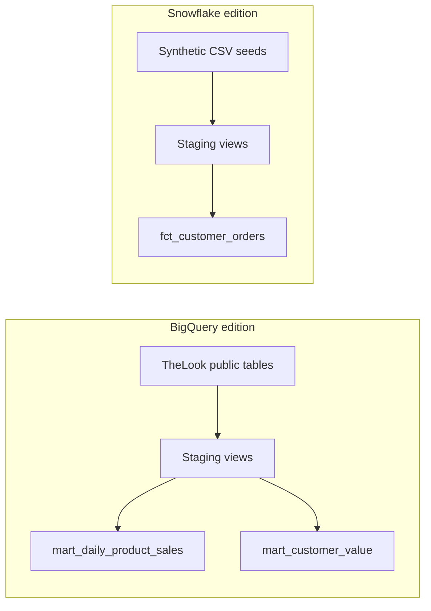

# First-run walkthrough

This repository contains two independent dbt examples. Choose one edition, follow its setup guide, and keep its credentials and generated artifacts separate. You do not need to run both to evaluate the kit.

## Before you run dbt

`scripts/first_run_preflight.py` is an offline check. It makes no network call, never reads or prints profile contents or credential values, and never creates or overwrites a profile. It checks Python 3.11, the dbt CLI and adapter, the edition's project and dependency files, an edition-local `.dbt/profiles.yml` selected through `DBT_PROFILES_DIR`, and that the target variables are set (`BQ_PROJECT`; or `SNOWFLAKE_DATABASE` and `SNOWFLAKE_SCHEMA`). It refuses target names that look production-like (for example `prod`, `live`, `shared`, `customer`) or that reuse the legacy shared development default, and it exits `1` with a next step for each item to fix. Do not run dbt until it exits `0`.

Keep the profile inside the edition workspace. If you already use `~/.dbt/profiles.yml`, merge the edition's profile key (`retail_analytics` or `reliable_pipeline`) into it instead of copying the example over it; the preflight suggests `cp -n`, which never overwrites an existing file. Before a release or customer acceptance run against a real warehouse, follow the [cloud acceptance runbook](cloud-acceptance-runbook.md), which is a human-gated step.

## Data flow



## Run the BigQuery example

Complete [BigQuery setup](../editions/Bigquery/docs/setup.md), then from the repository root run the local preflight and dbt commands:

```sh
python scripts/first_run_preflight.py bigquery --workspace editions/Bigquery
cd editions/Bigquery
dbt debug
dbt build
```

The build reads TheLook public tables and writes to your configured BigQuery dataset. Inspect `mart_daily_product_sales` for daily product-level completed sales and returns, and `mart_customer_value` for customer-level completed order counts and revenue. Revenue is gross item sale value, not profit. BigQuery execution uses your project and can incur query charges; the profile's bytes-billed setting is a per-query guardrail, not a total spending cap.

Example query for the customer mart (replace the project and dataset):

```sql
select user_id, country, completed_order_count, completed_revenue
from `your-gcp-project.dbt_retail.mart_customer_value`
order by completed_revenue desc
limit 10;
```

Example query for daily product performance:

```sql
select order_item_date, product_name, completed_revenue, returned_value
from `your-gcp-project.dbt_retail.mart_daily_product_sales`
order by order_item_date desc, completed_revenue desc
limit 10;
```

## Run the Snowflake example

Complete [Snowflake setup](../editions/Snowflake/docs/setup.md), then from the repository root run the local preflight and dbt commands:

```sh
python scripts/first_run_preflight.py snowflake --workspace editions/Snowflake/kit
cd editions/Snowflake/kit
dbt debug
dbt build
```

The build loads synthetic customer and order seeds, creates staging views, then builds `fct_customer_orders`. The mart has one row per customer with completed order count, gross completed revenue, and most recent completed order date. Use the isolated development warehouse and database described in the setup guide.

Example query using the default Terraform disposable target (replace the database and schema if you selected another `DBT_KIT_DEV_*` target):

```sql
select customer_id, customer_name, completed_order_count, completed_revenue
from DBT_KIT_DEV_TF_DB.DBT_KIT_DEV_TF_SCHEMA.FCT_CUSTOMER_ORDERS
order by completed_revenue desc
limit 10;
```

## Explore the results

- In BigQuery, inspect the target dataset configured by `BQ_PROJECT` and `BQ_DATASET`.
- In Snowflake, inspect `DATABASE.SCHEMA.FCT_CUSTOMER_ORDERS` in Snowsight, substituting the database and schema in your local profile.
- Review dbt's terminal output for model and data-test results. BigQuery pull-request CI only parses project configuration; its manual warehouse build requires configured GCP identity and a dedicated dataset. Snowflake pull requests parse without credentials; trusted pushes to `main` use repository secrets and check that the database/schema names match the `DBT_KIT_CI_<suffix>_DB` / `DBT_KIT_CI_<suffix>_SCHEMA` pattern. The naming check does not prove resources are disposable or isolated; provision and control them using the [Snowflake Terraform guide](../editions/Snowflake/infra/terraform/README.md).

For a dashboard starting point, follow the [BigQuery README's Looker Studio suggestion](../editions/Bigquery/README.md#dashboard-idea). The Snowflake example is designed to demonstrate dbt modeling and tests; it does not include dashboard configuration.

For an independent setup evaluation, use the [first-run checklist](first-run-checklist.md). See the [operations guide](operations-and-observability.md) for run artifacts and monitoring limits.

The preflight only checks local files, Python/dbt installation, profile path isolation, and the BigQuery project variable. It never reads credential values or contacts either warehouse. A passing preflight does not replace `dbt debug` or a review of the intended non-production target.
