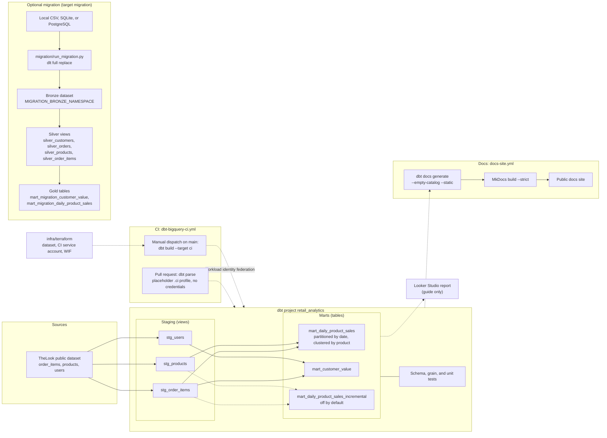

# BigQuery architecture

This diagram shows how the BigQuery edition fits together, based on the files in `editions/Bigquery/`, `migration/`, `scripts/`, and the edition's CI workflows. Dashed lines are optional or manually triggered paths. Terms are defined in the [glossary](../../../docs/glossary.md).

## How to read it

- **Sources to marts.** Staging models read the three TheLook tables in place and standardize names, types, and statuses. Marts aggregate staged rows; see the [mart contract](../../../docs/mart-contract.md) for each grain and metric.
- **Incremental example.** `mart_daily_product_sales_incremental` builds only when `enable_incremental_example` is true. It rebuilds a configurable lookback window of date partitions with `insert_overwrite`; see the [overview](../README.md).
- **Tests.** `models/schema.yml` declares column tests, and `tests/` holds singular grain tests for the daily marts.
- **Migration.** The Silver and Gold models are enabled only for the `migration` target with `enable_migration_models: true`. They read the Bronze dataset that the [migration loader](../../../migration/README.md) writes. The full warehouse migration flow has not been validated end to end.
- **CI.** Pull requests run a credential-free `dbt parse`, including the migration models. A warehouse build runs only from a manual dispatch on `main`, against a `starterkit_`-prefixed dataset that the [Terraform module](../infra/terraform/README.md) provisions.
- **Docs.** `scripts/build_docs_site.sh` generates dbt docs without warehouse access and builds this site. Column metadata is empty in published builds.
