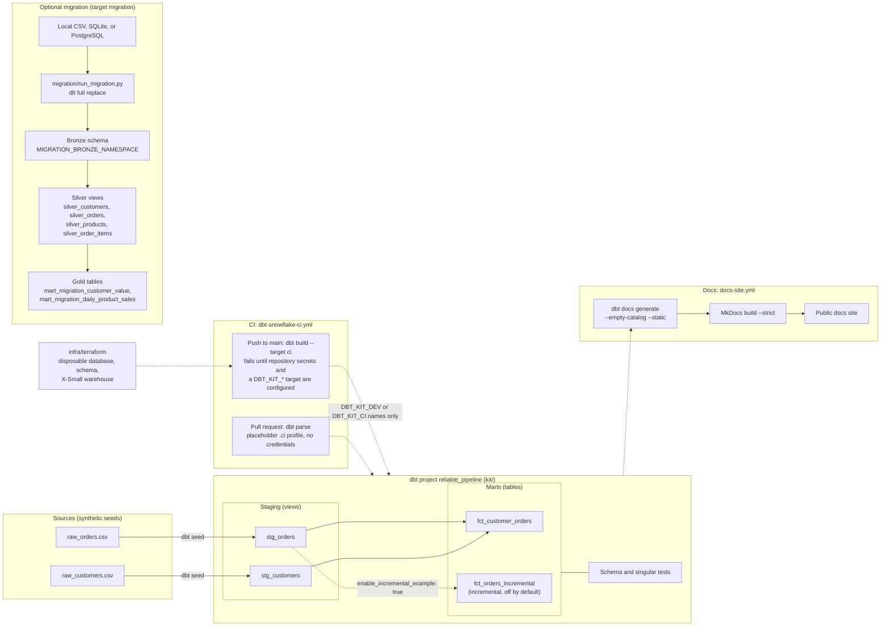

# Snowflake architecture

This diagram shows how the Snowflake edition fits together, based on the files in `editions/Snowflake/`, `migration/`, `scripts/`, and the edition's CI workflows. Dashed lines are optional or conditional paths. Terms are defined in the [glossary](../../../docs/glossary.md).

## How to read it

- **Sources to marts.** `dbt seed` loads two synthetic CSV files: three customers and six orders, with no product or item rows. Staging standardizes them and `fct_customer_orders` aggregates one row per customer; see the [mart contract](../../../docs/mart-contract.md).
- **Incremental example.** `fct_orders_incremental` reads `stg_orders` and is disabled unless you set the `enable_incremental_example: true` variable, so it is drawn with a dashed line. It reprocesses a short lookback window on each run; the [operations guide](operations.md) describes how to run and full-refresh it.
- **Migration.** The Silver and Gold models are enabled only for the `migration` target with `enable_migration_models: true`. They read the Bronze schema that the [migration loader](../../../migration/README.md) writes; see [Snowflake migration](migration.md). The full warehouse migration flow has not been validated end to end.
- **CI.** Pull requests run a credential-free `dbt parse`, including the migration models. Pushes to `main` that touch the edition run `dbt build`; the job fails until the repository secrets are configured and the database and schema match the Terraform naming rule. The [Terraform module](../infra/terraform/README.md) creates that disposable target.
- **Docs.** `scripts/build_docs_site.sh` generates dbt docs without warehouse access and builds this site. Column metadata is empty in published builds.
